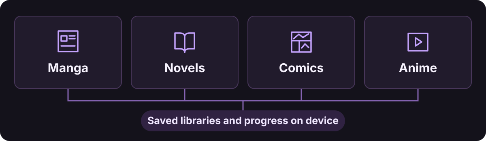

# Infinit Manga

Infinit Manga is a SwiftUI app for reading manga, novels, and comics and watching anime on iPhone. Each mode has its own library and picks up where you left off.



[Build for iPhone](#build-for-iphone) · [Run the web reader](#run-the-web-reader) · [Contribute](#contribute)

## What you can do

| Mode | Features |
| --- | --- |
| Manga | Browse and search configured sources, bookmark series, and resume at the last page. |
| Novels | Read with continuous scroll or horizontal pages. Adjust the text size and switch between paper, sepia, and night themes. |
| Comics | Import CBZ, CBR, ZIP, RAR, or PDF files from Files. Read imported comics offline and resume at the last page. |
| Anime | Browse episodes and track watch progress. Direct playback and resume depend on the source. |

Bookmarks, reading lists, and progress are stored on the device. Browsing and playback use the selected source, and availability can change independently of the app.

## Build for iPhone

1. On a Mac with Xcode, open the checked-in project:

   ```sh
   open ios/Papertrail.xcodeproj
   ```

2. Select the **Papertrail** scheme and an iPhone simulator. Let Xcode resolve SwiftSoup, then press **Run**.
3. For a physical iPhone, select your own signing team and use a bundle identifier registered to your team.

The deployment target is iOS 17. The project file is checked in. If you edit [`ios/project.yml`](ios/project.yml), regenerate it with `cd ios && xcodegen generate`.

The Manga Agent uses catalog search through MangaDex by default in the public build. To use a relay you operate, set the `MANGA_AGENT_ENDPOINT` build setting to its HTTPS URL.

## Run the web reader

The Node.js web reader is a separate local interface for manga. It requires Node.js 22 or later.

```sh
npm ci
npm start
```

Open [`http://127.0.0.1:43921`](http://127.0.0.1:43921). You can choose a different local port with `PORT`.

## Contribute

Open a pull request for changes to the default branch. [The project owner](.github/CODEOWNERS) reviews every contribution before it can merge.

For reader, player, or source changes, include what you tested and the simulator or device you used. Use original, public-domain, or otherwise permitted media for fixtures and screenshots.

## License

The project source and documentation are available under the [MIT License](LICENSE). Media and branding from third-party sources retain their own rights and terms.
